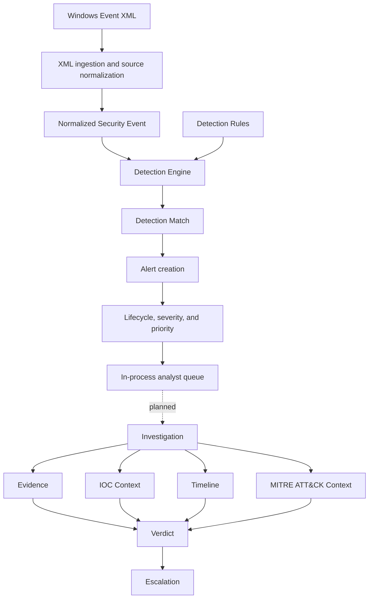

# System Architecture

## Architecture Status

The v0.1.0 Project Foundation, v0.2.0 Event Processing, v0.3.0 Detection Engine, and v0.4.0 Alert Management milestones are released. Investigation, enrichment, persistence, the backend API, and the analyst web UI remain planned. See the [Event Processing](event-processing.md), [Detection Engine](detection-engine.md), and [Alert Management](alert-management.md) architecture documents for each implemented layer.

The architecture defines conceptual responsibilities and data flow. It does not prescribe low-level classes, database tables, endpoints, or deployment topology.

## Architectural Style

The Python backend follows a modular monolith design with clear internal boundaries. Parsing, normalization, detection, and Alert Management are implemented as in-process modules. Planned investigation, enrichment, persistence, and API behavior fit within the same design.

This style fits the project's deliberately small scope because it supports easier debugging, deterministic local execution, lower operational complexity, straightforward testing, and direct inspection of security logic. Those qualities are especially valuable for an educational and portfolio project.

The conceptual backend shape is:

```text
Backend application
├── Parsing and normalization
├── Detection
├── Alert Management
├── Investigation (planned)
├── Enrichment (planned)
├── Persistence (planned)
└── API (planned)
```

Internal boundaries should remain explicit so responsibilities can be tested independently and refactored later if evidence justifies a different design.

## High-Level Data Flow

The v0.3.0 Detection Engine ends at `DetectionMatch`. Alert Management, released in v0.4.0, consumes that evidence and ends at the in-process analyst queue. The dashed edge marks the start of planned Investigation behavior.



The implemented XML ingestion reads one supported raw event representation without making detection decisions. The registry and source normalizers produce a validated, source-independent `NormalizedEvent`. The implemented Detection Engine evaluates one event against validated rules and emits a match only for a TRUE root condition, preserving its complete ordered `ConditionTrace`. It does not correlate multiple events.

In the planned downstream stages, an investigation would associate related events, evidence, IOCs, timeline entries, and supported MITRE ATT&CK context with an Alert. The analyst would use that context to record a False Positive or True Positive verdict and prepare escalation information when required.

## Core Domain Objects

`RawWindowsEvent`, `NormalizedEvent`, `DetectionRule`, `ConditionTrace`, `DetectionMatch`, and `Alert` are implemented typed contracts. The workflow concepts from Investigation onward are planned.

- **Raw Security Event:** source-shaped Windows Event Log or Sysmon telemetry before normalization.
- **Normalized Security Event:** a consistent event representation used by detection and investigation components.
- **Detection Rule (implemented):** bounded declarative criteria and descriptive metadata, validated structurally and semantically during loading.
- **Detection Match (implemented):** evidence that one specific rule matched one normalized event, with rule identity/version and complete condition trace; not an Alert or verdict.
- **Alert (implemented):** immutable analyst-facing work with owned detection evidence, a caller-supplied identity, UTC timestamps, lifecycle state, severity, and priority.
- **Investigation:** the record that organizes analysis of an alert and its related activity.
- **Evidence:** event-derived facts or analyst-selected observations supporting a decision.
- **IOC Context:** identified indicators and available enrichment relevant to the investigation.
- **Timeline Entry:** a time-ordered activity record used to reconstruct what occurred.
- **MITRE ATT&CK Context:** supported mappings between observed behavior and ATT&CK techniques.
- **Verdict:** the analyst's evidence-based False Positive or True Positive conclusion and rationale.
- **Escalation:** a structured handoff containing priority, severity, evidence, findings, and recommended actions.

## Component Responsibilities

### Telemetry and Datasets

Telemetry inputs provide deterministic Windows Event Log and Sysmon examples for parsing, detection, testing, and investigation scenarios. Initial inputs should be synthetic, sanitized, or generated in a controlled lab and should enter through files, fixtures, or controlled datasets. This component does not provide enterprise-scale collection or live endpoint telemetry.

### Parsers

Parsers understand source-specific event formats, validate required source fields, preserve relevant provenance, and convert raw records into data suitable for normalization. They do not evaluate detection rules, create alerts, or decide investigation outcomes.

### Schemas and Normalization

Schemas define stable contracts for information passed between components. Normalization maps supported source fields into a consistent security-event representation, records source identity, and handles validation failures explicitly. Downstream detection logic should depend on normalized semantics rather than individual raw formats.

### Detection Rules

Detection rules express transparent, reviewable conditions and metadata for observable behavior. Six initial YAML rules are implemented under `rules/windows/`, separate from the evaluation runtime so they can be inspected, versioned, and tested independently. They are educational triage signals, not maliciousness verdicts. See [Rule Authoring](../detections/rule-authoring.md).

### Detection Engine

The loader safely reads the controlled rule library and validates structure, shared field/type semantics, and duplicate identities before returning a complete rule tuple. The engine filters by category/source and evaluates one normalized event in rule-ID order with three-valued conditions and complete traces. It produces TRUE-only detection matches, not partial results after errors. The shared semantic layer also supports defensive runtime validation. It does not own alert workflow, analyst notes, or verdict decisions. Detailed responsibilities and failure semantics are in [Detection Engine Architecture](detection-engine.md).

### Alert Management

Alert Management creates validated Alerts from TRUE matches, keeps rule and event evidence detached, and applies explicit lifecycle and policy changes. The stateless queue validates, filters, and sorts the collection supplied by the caller. See [Alert Management Architecture](alert-management.md).

The remaining component responsibilities are planned.

### Investigation

The investigation component organizes alert triage and deeper analysis. It associates related events, evidence, analyst notes, timeline entries, hypotheses, and conclusions with an alert. It coordinates investigation state without embedding source parsing or detection-rule evaluation.

### Enrichment

Enrichment adds investigation context derived from IOCs and supported MITRE ATT&CK mappings. Enrichment results should retain their source and uncertainty, and failures should not erase the underlying evidence. This component supports analyst reasoning; it does not make autonomous containment or verdict decisions.

### Verdict and Escalation

Verdict handling records an evidence-based False Positive or True Positive conclusion, rationale, and final severity and priority assessment. Escalation produces a structured handoff for a higher-tier analyst, including relevant evidence, timeline, IOC and ATT&CK context, findings, and recommended actions.

### Persistence

Persistence stores and retrieves domain information through explicit repository or storage interfaces. It is responsible for data durability and query behavior, not security decisions. The initial architecture does not mandate a particular database technology, distributed storage system, or retention model.

### API

The backend API exposes application operations and validated representations to the analyst interface. It should delegate domain work to the relevant modules, translate transport concerns at the boundary, and avoid duplicating detection or investigation logic in endpoint handlers.

### Analyst Interface

The analyst interface presents alert queues, event context, investigations, evidence, timelines, enrichment, verdicts, and escalation reports. It communicates with the backend API and should not reimplement backend detection or investigation decisions. The interface is planned and is not currently functional.

## Repository Mapping

The intended mapping between architecture responsibilities and repository areas is:

| Repository path | Architectural responsibility | Status |
| --- | --- | --- |
| `datasets/` | Controlled telemetry and reusable dataset inputs | Foundation placeholder |
| `rules/windows/` | Reviewable Windows and Sysmon detection rules | Six initial rules implemented and tested |
| `backend/app/parsers/` | XML ingestion, explicit registry, pipeline, and source-specific normalization | Implemented v0.2.0 boundary |
| `backend/app/schemas/` | Future input and transport-boundary contracts; implemented event models live under `backend/app/models/` | Foundation placeholder |
| `backend/app/detection/` | Safe rule loading, shared semantic validation, evaluator, and single-event engine | Released in v0.3.0 |
| `backend/app/investigation/` | Investigation behavior, evidence, timelines, verdicts, and escalation | Foundation placeholder |
| `backend/app/models/` | Raw and normalized events, detection contracts, and Alert contracts | Implemented |
| `backend/app/alerts/` | Alert creation, lifecycle, severity and priority, and in-process queue | Released in v0.4.0 |
| `backend/app/services/` | Application-level orchestration across domain responsibilities | Foundation placeholder |
| `backend/app/core/` | Narrow shared configuration and foundational concerns | Foundation placeholder |
| `backend/app/api/` | Backend transport boundary | Foundation placeholder |
| `frontend/` | Analyst-facing web interface | Foundation placeholder |
| `cases/` | Documented investigation scenarios and expected analyst outcomes | Foundation placeholder |
| `tests/fixtures/` | Reusable synthetic Windows Event XML telemetry | Seven event fixtures implemented |
| `tests/integration/` | Cross-component behavior validation | XML-to-event, XML-to-match, and XML-to-Alert integration and failure tests |
| `backend/tests/` | Models, parsers, detection, Alert operations, and smoke tests | Implemented component coverage |
| `docs/` | Architecture, detection, authoring, and future investigation documentation | Implemented boundaries documented through Alert Management |

These paths express intended ownership. Several currently contain only placeholders and must not be interpreted as implemented modules.

## Component Interaction Rules

- Raw source formats enter through parsers; downstream components consume normalized events.
- Detection rules remain data separate from the engine that evaluates them.
- Detection matches preserve traceability to the responsible rule and supporting event context.
- Alert management consumes detection matches and does not repeat detection evaluation.
- Investigation starts from an alert and may request related events or enrichment through explicit boundaries.
- Evidence remains distinguishable from derived enrichment and analyst conclusions.
- Verdicts and escalations record analyst reasoning; enrichment does not decide them automatically.
- API handlers and the analyst interface delegate domain behavior rather than duplicating it.
- Persistence adapters store domain state without deciding detection, severity, priority, or verdict outcomes.
- Internal dependencies should be explicit, testable, and free of avoidable cycles.
- Failure in optional enrichment should be visible but should not invalidate the original alert or evidence.

## Architecture Boundaries

The backend is not a microservice architecture. The initial design has no service-to-service networking, message broker, event bus, Kubernetes deployment, distributed tracing, internal API gateway, or independently deployed backend units. Those mechanisms would add operational complexity without supporting the current educational and investigation-centered scope.

The architecture also does not extend the project into a full SIEM, EDR, or SOAR platform. It favors explainability, deterministic behavior, reproducible investigations, testability, and maintainability over enterprise ingestion volume, distributed scale, or broad automation.

For the authoritative product boundaries and detailed non-goals, see [Project Scope](../project-scope.md).

Controlled telemetry must not include production credentials, secrets, personal data, or confidential enterprise logs. Security decisions should remain traceable to available evidence and transparent rules.

## Planned Evolution

The roadmap distinguishes released and planned stages.

- **v0.2.0 — Event processing and normalization:** released and completed, with supported event parsing, validation, and normalized-event contracts.
- **v0.3.0 — Detection Engine:** released. Includes rule contracts, safe loading and semantic validation, deterministic single-event evaluation, complete traces, six Windows rules, and XML-to-match integration.
- **v0.4.0 — Alert Management** is released. It includes Alert creation, lifecycle transitions, independent severity and priority, and in-process queue reads.
- **v0.5.x — Investigation workflow:** introduce triage, related-event analysis, evidence, timelines, analyst notes, verdicts, and escalation workflow.
- **v0.6.x — IOC and MITRE ATT&CK enrichment:** introduce IOC extraction and enrichment, ATT&CK mappings, and supporting investigation context.
- **v0.7.x — Investigation cases:** introduce documented investigation scenarios with evidence, timelines, mappings, verdicts, and escalation reports.
- **v0.8.x — Analyst web interface:** introduce the analyst-facing experience for alerts, investigations, timelines, IOC context, verdicts, and reports.

Module boundaries may be refined as concrete requirements emerge. A distributed design should be considered only if measured constraints justify it; future refactoring should not be driven by speculative scale. Until then, the modular monolith remains the planned deployment and development model.

